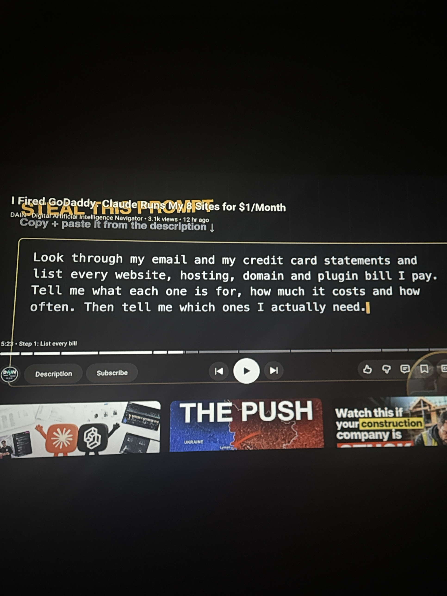

# Audyt subskrypcji WWW (hosting, domeny, wtyczki)

**Źródło:** YouTube — *„I Fired GoDaddy. Claude Runs My 8 Sites for $1/Month”*, kanał DAIN – Digital Artificial Intelligence Navigator (krok 1: „List every bill”, 5:23).
**Zapisano:** 2026-10-04

## Prompt (oryginał, EN)

```
Look through my email and my credit card statements and list every website, hosting, domain and plugin bill I pay. Tell me what each one is for, how much it costs and how often. Then tell me which ones I actually need.
```

## Prompt (PL)

```
Przejrzyj mój e-mail i wyciągi z karty kredytowej i wypisz każdy rachunek za strony internetowe, hosting, domeny i wtyczki, który opłacam. Powiedz mi, do czego służy każdy z nich, ile kosztuje i jak często jest pobierana opłata. Potem powiedz mi, których z nich naprawdę potrzebuję.
```

## Jak używać

- Wymaga podłączonego Gmaila (connector) — Claude przeszukuje faktury/potwierdzenia płatności.
- Wyciągi z karty: wgraj PDF/CSV do rozmowy (Claude nie ma dostępu do banku).
- Efekt: tabela usług (cel, koszt, częstotliwość) + rekomendacja: zostawić / zrezygnować / przenieść.


